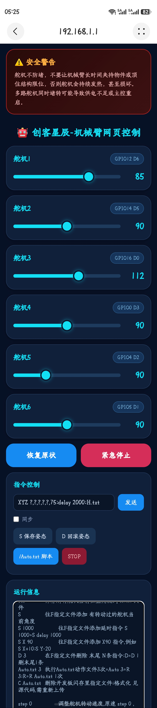

# 六轴 MG90S：参数、接线与问答

[返回型号列表](../README.md)

**适用范围：共享资料中的六轴 MG90S 版本，ESP8266 D1 Mini 控制板。** 下单名称相似不代表舵机相同；先核对实物舵机标签和套餐规格。含控制板的套餐发货前已烧录。

## 网页控制界面

以下是六轴 MG90S 工程的手机控制页截图，不是整机实物。店铺另有六轴 SG90 商品，未将其商品图用作 MG90S 实物图。

## 接线与控制

下表按网页顺序排列。角度是该固件的默认范围，不代表所有装配姿势都能走满。

| 网页 | 部位 | 指令 | 信号口 | 固件默认角度范围 |
| --- | --- | --- | --- | --- |
| 舵机 1 | 夹爪 | `E` | `D6 / GPIO12` | 45°–100° |
| 舵机 2 | 旋转 | `T` | `D5 / GPIO14` | 55°–180° |
| 舵机 3 | 平衡 | `B` | `D0 / GPIO16` | 0°–180° |
| 舵机 4 | 上下 | `Z` | `D3 / GPIO0` | 0°–180° |
| 舵机 5 | 前后 | `Y` | `D2 / GPIO4` | 0°–180° |
| 舵机 6 | 底座 | `X` | `D1 / GPIO5` | 0°–180° |

这是信号口对照，不是电源容量表。接线前断电，对照随货扩展板的供电和地线标识；整机请使用匹配的电源，不照搬五轴的电源规格。

## 上手与重新烧录

- 手机或电脑连热点「6轴机械臂（密码8个8）」，默认密码 `88888888`，用浏览器打开 `http://192.168.1.1/`。首次逐路小幅测试，确认夹爪、旋转和平衡三路没有插反。
- 要改代码时，从[六轴源码入口](https://gitee.com/zhouhao2528/chuangkexingchenjixiebiliuzhou)打开含 `platformio.ini` 的工程，用 PlatformIO 的 `d1_mini` 环境编译并通过数据线烧录。控制网页已经内置，缺失的默认脚本会在首次启动时生成；常规使用不需另刷文件系统。

## 买家常问

**五轴固件能刷到六轴控制板吗？** 不建议。尽管主控板同为 D1 Mini，舵机数量、信号脚和命令对应关系不一样。

**装好找不到热点，或一直进不了控制页？** 先检查电源和手机是否连对热点。舵机 4 的 `D3 / GPIO0` 是启动脚；如果怀疑启动失败，可断电后暂时拔下它的信号线，再单独上电排查，不要带电拆插。

**舵机转到一半卡住或发烫？** 立即停止并断电，检查装配干涉、舵臂位置与接线。不要靠把角度上限调大来强行通过卡点。
