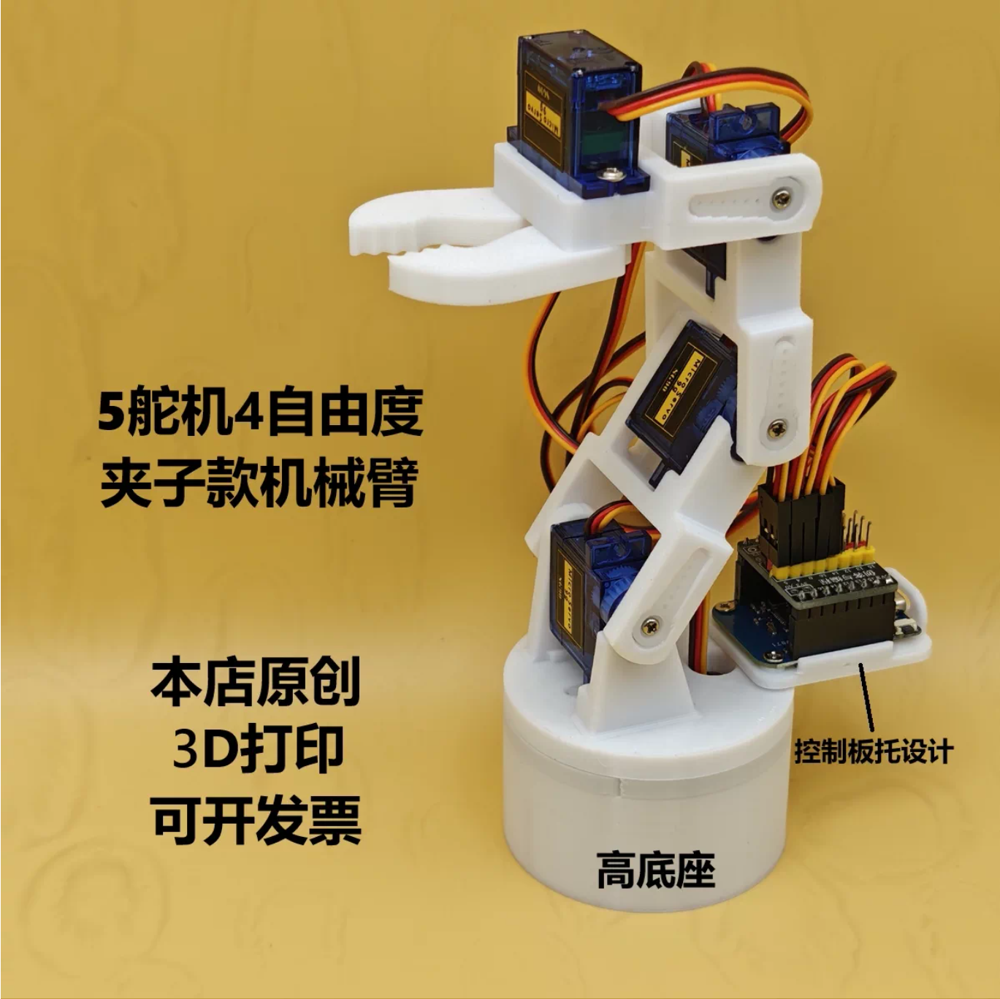

# 五轴 SG90：参数、接线与问答

[返回型号列表](../README.md)

**适用范围：五路 SG90、ESP8266 LOLIN D1 Mini 配套控制板。** 和四轴相比，这款多一路腕部控制。含控制板的套餐发货前已烧录；不含板的套餐请先确认自备板型号。

## 配套硬件购买

五轴 SG90 可在[淘宝店「精焊创客电子」](https://shop372256150.taobao.com/)的[五轴商品页](https://item.taobao.com/item.htm?id=1031339294727)选购。想配齐本页对应的硬件，请选「5 个 SG90 舵机 + 控制板」的套餐，再按需要选高底座或低底座、散件或成品。

## 商品实物

图源：[店铺五轴商品详情](https://item.taobao.com/item.htm?id=1031339294727)。图中为高底座款，具体配件以所选套餐为准。

## 接线与供电

| 网页顺序 | 部位 | 指令 | 信号口 | 固件默认角度范围 |
| --- | --- | --- | --- | --- |
| S1 | 夹爪 | `E` | `D5 / GPIO14` | 45°–100° |
| S2 | 腕部 | `B` | `D0 / GPIO16` | 0°–180° |
| S3 | 小臂 | `Z` | `D3 / GPIO0` | 0°–180° |
| S4 | 大臂 | `Y` | `D2 / GPIO4` | 55°–180° |
| S5 | 旋转底座 | `X` | `D1 / GPIO5` | 0°–180° |

断电后再插线。扩展板供电为 5V，舵机与主控共地；红线接 5V，棕色或黑色接 GND，信号线按上表接。五路 SG90 的参考电源是 5V/3A。固件角度限位不能代替机械限位，初次上电请小幅逐轴检查。

## 上手与重新烧录

- 手机或电脑连「5舵机械臂（密码8个8）」，默认密码 `88888888`；没有自动弹页时，在浏览器地址栏输入 `http://192.168.1.1`。本地网页控制不需要装 App。
- 网页按 S1 到 S5 排列；写指令时按字母找部位，例如 `B` 是腕部、`E` 是夹爪，不能照抄四轴程序。
- 如需改程序，从[五轴源码入口](https://gitee.com/zhouhao2528/maker-star-mechanical-arm)打开对应 PlatformIO 工程，确认 `platformio.ini` 中是 `d1_mini`，连接数据线后 `Build` → `Upload`。网页和默认脚本随固件，无需另传网页。

## 买家常问

**插好小臂后，板子上电不启动怎么办？** S3 的 `D3 / GPIO0` 也是启动配置脚。断电后暂时拔下 S3 的信号线，再单独上电观察是否恢复。不要带电插回或擅自换脚；如断开后恢复，先检查扩展板和接线，再联系店铺确认。

**某一路动错了部位？** 先断电按 S1–S5 顺序核线。五轴的夹爪是 `D5`，不是四轴夹子款的 `D0`。

**多路同时动就断网、抖动或重启？** 检查供电是否达到 5V/3A、接头是否松动，并回到单路、短行程测试。发现卡滞、持续异响或发热先断电。
